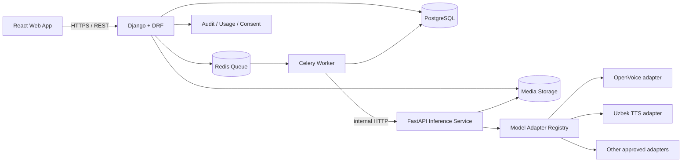

# Voice Clone AI — System Design & Product Blueprint

**Versiya:** 1.0  
**Sana:** 2026-10-11  
**Maqsad:** Lokal ishlay oladigan, o‘zbek/rus/ingliz tillarida ovoz sintezi va rozilik asosidagi ovoz klonlashni ta’minlaydigan, keyinchalik SaaS/API xizmatiga kengayadigan mahsulot uchun texnik asos.

> **Muhim chegaralar:** “Har qanday ovozni 100% klonlash” texnik jihatdan kafolatlanmaydi. Sifat ovoz yozuvi, til, aksent, model, matn va apparatga bog‘liq. Mahsulot foydalanuvchining o‘z ovozi yoki foydalanishga aniq ruxsat berilgan ovozlar bilan ishlashi kerak. Boshqa odam nomidan aldov, firibgarlik yoki roziliksiz taqlid qilish uchun mo‘ljallangan funksiyalar qo‘shilmaydi.

---

## 1. Mahsulot maqsadi

### 1.1 MVP nimani bajaradi?

1. Foydalanuvchi hisob ochadi yoki lokal rejimda shaxsiy ish maydonini ishga tushiradi.
2. O‘z ovozini yozadi/yuklaydi va ovozdan foydalanish huquqi borligini tasdiqlaydi.
3. Tizim ovoz faylini tekshiradi: format, davomiylik, shovqin, clipping, ovoz mavjudligi.
4. Foydalanuvchi matn va tilni tanlaydi: o‘zbek (lotin alifbosi birinchi), rus yoki ingliz.
5. Tizim model adapteri orqali audio yaratadi; uzun matnlar bo‘laklarga bo‘linadi.
6. Foydalanuvchi audio tinglaydi, qayta yaratadi va WAV formatida yuklab oladi.
7. Ishlar tarixi, limitlar, fayllarni o‘chirish va audit ko‘rinadi.

### 1.2 MVPga kiritilmaydi

- Istalgan odamning ovozini roziliksiz klonlash yoki shaxsni taqlid qilishni osonlashtiruvchi anonim “celebrity voice” katalogi.
- Birinchi relizda real-time voice changer, telefon qo‘ng‘irog‘i integratsiyasi va katta hajmda model fine-tuning.
- Barcha tillarda sifatni kafolatlash.
- Dastlabki kundanoq microservices/Kubernetes. Avval sodda, o‘lchanadigan arxitektura.

### 1.3 Dastlabki auditoriya

- Video mualliflari va kontent yaratuvchilar.
- O‘zbekcha/ruscha/inglizcha ta’lim kontentlari tayyorlovchilar.
- Podcast, audiokitob va dublaj ishlab chiqaruvchilar.
- Ruxsat asosida brend ovozi yoki o‘zining ovoz profilini yaratmoqchi bo‘lgan kichik bizneslar.

---

## 2. Model strategiyasi: modelga qamalib qolmaslik

Bitta modelni hozirdanoq yakuniy deb belgilamang. Dastlab kichik benchmark loyihasi qiling va modelni quyidagi mezonlar bilan baholang:

| Nomzod | Foydalanish | Til holati | Tijorat bo‘yicha izoh | Qaror |
|---|---|---|---|---|
| OpenVoice V2 | Ovoz tembrini klonlash; mos bazaviy TTS bilan sinash | V2 native: ingliz, ispan, fransuz, xitoy, yapon, koreys. Boshqa til uchun mos base TTS zarur bo‘lishi mumkin | Rasmiy repo MIT; baribir bog‘liq komponentlar litsenziyasini alohida tekshirish | Birinchi texnik tajriba |
| Anadil Uzbek TTS | O‘zbekcha TTS/voice-prompt tajribasi | O‘zbekcha yo‘nalish | Model kartasida MIT deb ko‘rsatilgan; og‘irliklar, upstream va dataset shartlari releasdan oldin tekshiriladi | O‘zbekcha benchmark nomzodi |
| XTTS-v2 | Rus/ingliz tilida tez taqqoslash | Rasmiy ro‘yxatda rus va ingliz bor; o‘zbek yo‘q | Coqui Public Model License tijorat foydalanishida muhim cheklov tug‘dirishi mumkin | Faqat qonuniy/texnik baholash; tijorat uchun avtomatik tanlamaslik |
| GPT-SoVITS | Few-shot TTS va cross-language tajriba | Rasmiy README’da ingliz, yapon, koreys, kanton va xitoy ko‘rsatilgan; o‘zbek/rus uchun kafolat yo‘q | Kod litsenziyasi bilan birga tanlangan checkpoint va dataset shartlarini tekshirish | Ixtiyoriy benchmark |
| F5-TTS | Sifat/tezlik taqqoslash | Til va checkpoint bo‘yicha test talab qilinadi | Kod MIT bo‘lishi model vaznlari MIT degani emas; rasmiy repo vaznlarni CC-BY-NC deb ko‘rsatadi | Tijoratga ruxsat aniqlanmaguncha mahsulotga kiritmaslik |

**Manbalar:**
- OpenVoice: https://github.com/myshell-ai/OpenVoice
- Anadil Uzbek TTS: https://huggingface.co/Anadilorg/Anadil_Uzbek_TTS
- XTTS-v2: https://docs.coqui.ai/en/latest/models/xtts.html
- GPT-SoVITS: https://github.com/RVC-Boss/GPT-SoVITS
- F5-TTS: https://github.com/SWivid/F5-TTS

**Litsenziya qoidasi:** Har bir deploy qilinadigan model uchun `MODEL_LICENSES.md` faylida kod, weights/checkpoint, upstream base model, tokenizer, dataset va tijorat shartlari alohida yozilsin. Litsenziya noaniq bo‘lsa, model monetizatsiya qilinadigan production muhitiga chiqarilmaydi.

### 2.1 Benchmark mezonlari

- Til: o‘zbek lotin, o‘zbek kirill (keyingi bosqich), rus, ingliz.
- Sifat: ona tilida so‘zlovchilar tomonidan 1–5 oralig‘ida tabiiylik, talaffuz, pauza va tembr o‘xshashligi bahosi.
- Aniqlik: ism, raqam, sana, qisqartma, apostrofli harflar (`o‘`, `g‘`), `sh`, `ch`, `ng`, x/q tovushlari.
- Tezlik: audio davomiyligiga nisbatan generatsiya vaqti (RTF), cold start, GPU/VRAM/RAM sarfi.
- Barqarorlik: 30–100 ketma-ket job, uzun matn, noto‘g‘ri audio, bo‘sh matn va worker qayta ishga tushish sinovlari.
- Tijoriy yaroqlilik: model va barcha dependency’lar litsenziyasi, attribution va redistributsiya majburiyatlari.

MVP modelini faqat benchmark natijalaridan keyin tanlang. Dastlabki target — birinchi o‘rinda o‘zbekcha tushunarli talaffuz, keyin rus/ingliz natijalari; barcha uch tilda teng sifat deb va’da bermang.

---

## 3. Tavsiya etiladigan texnologiyalar

### Backend

- Python 3.11/3.12: tanlangan AI kutubxonalari bilan moslikni sinab, bitta versiyani pin qilish.
- Django 5.2 LTS + Django REST Framework: foydalanuvchilar, profil, ruxsatlar, ishlar tarixi, limitlar, admin va asosiy API.
- FastAPI: faqat alohida **AI Inference Service** uchun. Model kutubxonalari, GPU va dependency’lar Django muhitidan ajratiladi.
- PostgreSQL: doimiy transactional ma’lumotlar.
- Redis + Celery: uzoq davom etadigan audio generatsiyasini fon vazifasiga aylantirish.
- FFmpeg + `soundfile`/`torchaudio` (model talabiga qarab): audio konvertatsiya va tekshiruv.
- S3-compatible storage (production) yoki lokal `MEDIA_ROOT` (offline); ko‘p faylli real muhit uchun MinIO ishlatilishi mumkin.

### Frontend

- React + Vite + TypeScript.
- Tailwind CSS va izchil komponentlar to‘plami.
- WAV upload, mikrofon yozuvi, waveform/vaqt ko‘rsatish, audio preview, progress/status, tarix va sozlamalar.
- API bilan OpenAPI schema orqali tiplarni sinxron saqlash.

### Infra va sifat

- Docker Compose: `web`, `worker`, `inference`, `postgres`, `redis`; GPU service uchun NVIDIA Container Toolkit talab qilinishi mumkin.
- Pytest + Django testlar, API contract testlar, Playwright (asosiy frontend oqimlari), Ruff, mypy (bosqichma-bosqich).
- Sentry yoki o‘z-o‘zini joylashtirilgan monitoring (productionda); Prometheus/Grafana foydalanuvchilar va yuk ortgandan keyin.

**FastAPI’ni butun backend uchun hozirdanoq ishlatish shart emas.** Django/DRF biznes qoidalari va auth uchun; FastAPI faqat GPU model servisi uchun. Bu ikki framework’ning vazifalari chalkashmaydi.

---

## 4. Yuqori darajadagi arxitektura

### 4.1 So‘rov qanday ishlaydi?

1. Frontend `POST /api/v1/generations/` orqali matn, til va tasdiqlangan voice profile ID yuboradi.
2. Django foydalanuvchi huquqi, consent statusi, matn hajmi, tarif/limit va request id’ni tekshiradi.
3. Database’da `GenerationJob(status=pending)` yaratiladi va Celery queue’ga beriladi.
4. Worker audio faylni storage’dan oladi, Inference API’ga ichki so‘rov yuboradi.
5. Inference service mos model adapterini tanlaydi, audio yaratadi va faylni storage’ga saqlaydi.
6. Worker job statusini `succeeded` yoki `failed` qiladi, sarflangan birliklarni yozadi.
7. Frontend job statusini polling orqali tekshiradi; keyinchalik WebSocket/SSE qo‘shish mumkin.

HTTP so‘rovi ochiq turgan paytda butun audio generatsiyasini bajarish tavsiya qilinmaydi: timeout, qayta urinish va parallel yuk muammolarini keltiradi.

### 4.2 Lokal va server rejimi

**Lokal/offline:** Django, React build, PostgreSQL/SQLite (faqat developer/demo), queue va model runtime bir kompyuterda ishlashi mumkin. Model weights oldindan yuklab olingan bo‘lishi kerak. Birinchi ishga tushirishda paket/modelni internetdan yuklash talab qilinishi mumkin; shuning uchun “offline” rejim alohida tekshiriladi.

**Production/server:** Django API bir yoki bir nechta web instansda, Celery workerlar alohida, inference GPU serverlari esa alohida ko‘paytiriladi. Barcha clientlarga model weights berilmaydi; API faqat serverda ishlaydi. Agar keyinchalik to‘liq desktop offline mahsulot kerak bo‘lsa, alohida desktop packaging/installer loyihasi bo‘ladi.

### 4.3 Kengaytirish qoidalari

- Avval **modular monolith + alohida inference service**; boshidan microservices ko‘paytirmaslik.
- Modelga bevosita endpointdan bog‘lanmaslik: `VoiceModelAdapter` interfeysi bo‘lsin.
- Har bir job idempotent bo‘lsin, idempotency key va retry siyosati bo‘lsin.
- Model versiyasi har bir generatsiya yozuvida saqlansin.
- CPU/GPU queue’larini model va resurs bo‘yicha ajratish mumkin bo‘lsin.
- Fayllar obyekt saqlashga ko‘chirilishi bilan kod buzilmasligi uchun `StorageBackend` interfeysi bo‘lsin.
- To‘lov, tarif, quota va usage hisobini model kodiga aralashtirmaslik.

---

## 5. Ma’lumotlar bazasi dizayni

Asosiy jadvallar:

### `users`
Django user modeli yoki custom user. Email/username, verification holati, created_at, account status.

### `voice_profiles`
- `id`, `owner_id`, `display_name`, `language_hint`, `status` (`pending`, `active`, `blocked`, `deleted`)
- `reference_asset_id`, `consent_id`, `model_compatibility_json`
- `created_at`, `updated_at`, `deleted_at`
- Ovoz namunasining o‘zini DB blob sifatida emas, storage key orqali saqlash.

### `consent_records`
- `id`, `owner_id`, `voice_profile_id`
- `consent_type` (`self_voice`, `authorized_third_party`, `licensed_voice`)
- tasdiqlash matni va versiyasi, timestamp, tekshiruv holati, zarur dalil metama’lumotlari
- maxfiy hujjat/audio dalilini saqlash va o‘chirish siyosati aniq belgilanadi.

### `audio_assets`
- `id`, `owner_id`, `storage_key`, `mime_type`, `duration_ms`, `sample_rate`, `channels`, `size_bytes`
- `sha256`, `validation_status`, `retention_until`, `created_at`

### `generation_jobs`
- `id`, `owner_id`, `voice_profile_id`, `status`, `input_text`, `language`, `model_id`, `model_version`
- `idempotency_key`, `progress`, `error_code`, `attempt_count`, `created_at`, `started_at`, `completed_at`
- Matn juda sezgir ma’lumot bo‘lishi mumkin: saqlashni foydalanuvchi tanlovi va retention siyosatiga bog‘lang.

### `generated_audio`
- `id`, `job_id`, `audio_asset_id`, `duration_ms`, `format`, `watermark_status`, `created_at`

### `model_registry`
- `id`, `name`, `version`, `adapter_key`, `supported_languages`, `license_review_status`, `enabled`, `config_json`
- Litsenziyasi tasdiqlanmagan model productionda `enabled=false` bo‘ladi.

### `usage_ledger`
- `id`, `user_id`, `job_id`, `unit_type`, `quantity`, `reason`, `created_at`
- Kvota hisobini audit qilinadigan ledger orqali yuriting; mijozning qoldig‘ini faqat frontend hisoblamasin.

### `audit_events` va `abuse_reports`
Admin amallari, consent holati o‘zgarishi, shubhali urinishlar, bloklash sababi va ko‘rib chiqish holati.

---

## 6. API shartnomasi (MVP)

Barcha endpointlar `/api/v1/` prefiksidan boshlanadi. Aniq schema DRF serializer/OpenAPI orqali keyin yaratiladi.

| Method | Endpoint | Vazifasi |
|---|---|---|
| POST | `/auth/register/` | Ro‘yxatdan o‘tish |
| POST | `/auth/token/` | Token/session olish |
| GET/PATCH | `/me/` | Foydalanuvchi va preference’lar |
| GET/POST | `/voices/` | Ovoz profillarini ko‘rish/yaratish |
| POST | `/voices/{id}/consent/` | Rozilikni qayd etish yoki tekshiruv so‘rash |
| POST | `/voices/{id}/validate/` | Ovoz namunasini tekshirish |
| GET/DELETE | `/voices/{id}/` | Profilni ko‘rish/o‘chirish |
| POST | `/generations/` | Generatsiya job’ini yaratish |
| GET | `/generations/{id}/` | Job statusi va natijasi |
| POST | `/generations/{id}/retry/` | Faqat retry mumkin bo‘lgan xatoda qayta ishga tushirish |
| GET | `/history/` | Foydalanuvchi tarixi |
| DELETE | `/assets/{id}/` | Foydalanuvchi faylini o‘chirish |
| GET | `/models/capabilities/` | Faol model va til imkoniyatlari |
| GET | `/usage/` | Limit/qoldiq va sarf tarixi |

Production API quyidagilarni bajaradi: request size limits, authentication, authorization, per-user rate limits, idempotency, strukturalangan error codes, pagination va API versioning.

---

## 7. Audio processing pipeline

1. **Upload intake:** fayl turi va haqiqiy MIME tekshiruvi; fayl nomiga ishonmaslik.
2. **Normalize:** mono/audio sample rate’ni model talabiga moslash; asl faylni zarur bo‘lsa alohida saqlash.
3. **Quality checks:** minimal/maksimal davomiylik, bo‘sh signal, clipping, shovqin, silence ratio.
4. **Consent gate:** rozilik va foydalanish huquqi tasdiqlanmagan voice profile bilan generatsiya yo‘q.
5. **Text normalization:** tilni tanlash, raqam/sana/URL o‘qilishi, o‘zbek apostroflari va tinish belgilari.
6. **Chunking:** katta matnni mazmuniy bo‘laklarga bo‘lish, yakunda kerak bo‘lsa audio bo‘laklarini birlashtirish.
7. **Synthesis:** model adapter, timeout va resurs limitlari.
8. **Post-processing:** loudness normalize, silence trim (ixtiyoriy), format conversion.
9. **Provenance:** mavjud bo‘lsa audio watermark/metadata va UI’da AI generated belgilari.
10. **Store & expire:** natijani saqlash va foydalanuvchi retention sozlamasiga ko‘ra tozalash.

---

## 8. Xavfsizlik, maxfiylik va ishonch

- O‘z ovozi yoki vakolatli ovozdan foydalanish aniq rozilik jarayoni bilan cheklanadi.
- Foydalanuvchi tasdiqlagan huquq yozuvi versiyalanadi; noaniq holatda profil tekshiruvga tushadi.
- Mashhur shaxs/uchinchi shaxsga o‘xshatish, firibgarlik yoki identity impersonation signallari uchun foydalanish siyosati va report/bloklash jarayoni bo‘ladi.
- Ovoz — biometrik jihatdan sezgir ma’lumot bo‘lishi mumkin: minimal yig‘ish, private-by-default, retention va delete endpointlari kerak.
- HTTPS, storage encryption, secret manager/environment secrets, least privilege, secure CORS, CSRF/session yoki token strategiyasini aniq tanlash.
- Audio upload uchun MIME va decoder tekshiruvlari, maksimal boyut, maksimal duration va rate limiting.
- Prompt/text loglarida shaxsiy ma’lumotni keraksiz saqlamaslik; logga to‘liq audio yoki token yozmaslik.
- Model fayllarini tekshirilgan manbadan yuklash, hash/version pin qilish.
- AI yaratilgan ovoz ekanini foydalanuvchiga ko‘rsatish; watermark/provenance usullari qo‘llab-quvvatlanganda yoqish.
- Account deletion vaqtida asset, generated files, cache va backup retention jarayoni hujjatlashtiriladi.
- Admin amallari auditga yoziladi; support xodimlariga ovoz faylini ko‘rish default ruxsat bo‘lmaydi.

Bu texnik dizayn yuridik maslahat emas. Ommaviy ishga tushirishdan avval O‘zbekiston va xizmat ko‘rsatiladigan boshqa bozorlardagi shaxsiy ma’lumot, mualliflik va rozilik talablari tekshiriladi.

---

## 9. Lokal ishlash talablari

Local rejimning ikki shaklini alohida ko‘ring:

**A. Developer local:** React dev server + Django + Redis/Postgres + model server. Internet paket yoki modelni dastlabki yuklashda talab qilinishi mumkin.

**B. Offline user app:** barcha zarur model fayllari bir marta o‘rnatilgan bo‘ladi; ish vaqtida tashqi APIga murojaat qilmaydi. Bu rejimni alohida acceptance test bilan tasdiqlash kerak.

GPU xotirasi va tezlik modelga bog‘liq. Minimal apparat talablarini taxmin bilan e’lon qilmang: benchmarkda CPU, turli VRAM hajmlari, cold start va uzun matnlar o‘lchanib, rasmiy talab belgilanadi. Windows developer mashinasi bo‘lishi mumkin, lekin GPU container/driver murakkabliklari sabab production uchun Linux deploymentni birinchi tanlov sifatida ko‘ring.

---

## 10. Kengayish yo‘li

### Bosqich 1 — Local Proof of Concept
Model benchmark, bitta til/ovoz pipeline’i, audio natija. Django va to‘liq billing hali shart emas.

### Bosqich 2 — Private MVP
Django/DRF, React, auth, voice profiles, jobs, tarix, local deployment, consent, delete.

### Bosqich 3 — Closed beta
GPU worker alohida, job queue, monitoring, rate limits, litsenziyasi tekshirilgan model, foydalanuvchi fikri va sifat benchmarki.

### Bosqich 4 — Paid SaaS
Tariflar, usage ledger, to‘lov provayderi, quota, invoice/receipt flow, support va abuse review.

### Bosqich 5 — Scale
Bir nechta inference worker/GPU, queue’larni prioritet/model bo‘yicha ajratish, object storage, CDN (public audio emas, private signed URLs), autoscaling metrics.

### Bosqich 6 — API / B2B
API keys, organization/workspace, per-tenant usage, webhook, SLA, admin analytics, biznes shartnomalari va litsenziyalar.

---

## 11. Daromad modeli: nimadan pul topish mumkin?

Daromad olish mumkin, lekin kafolat yo‘q. Faqat ovoz klonlash texnologiyasi yetarli emas: foydalanuvchi uchun ishonchli o‘zbekcha talaffuz, tezkorlik, qulay interfeys, maxfiylik va qonuniy foydalanish — sotiladigan qiymat bo‘ladi.

### Potensial yo‘llar

- **Freemium:** cheklangan bepul generatsiya; pullik rejada ko‘proq audio daqiqasi va navbat ustuvorligi.
- **Creator subscription:** kontent yaratuvchilar uchun ko‘proq quota, tarix, bir nechta tasdiqlangan ovoz profili va yuqoriroq eksport sifati.
- **B2B xizmat:** ta’lim, dublaj, audiokitob va marketing jamoalari uchun shartnoma, private workspace va API.
- **Local/private edition:** maxfiylik yoki internet cheklovi bo‘lgan mijozlarga o‘z serverida ishga tushirish, setup va texnik yordam.

### Boshlang‘ich narx sinovi (bozor fakti emas, validatsiya gipotezasi)

- Free: demo quota; abuse’ni cheklash.
- Creator: oyiga taxminan $5–$12 ekvivalentidan boshlab sinash.
- Pro: oyiga taxminan $15–$30 ekvivalentidan boshlab sinash.
- B2B: alohida kelishuv, hajm, GPU xarajati, SLA va litsenziya majburiyatlariga qarab.

Narxlarni aynan shunday qo‘yish shart emas. 15–30 potensial mijoz bilan suhbat, landing page va pullik pilot orqali sinab ko‘rish kerak. Ovoz yaratish xarajatlari GPU, audio davomiyligi, model throughput, saqlash va supportga bog‘liq. Har bir job uchun real xarajat o‘lchanmaguncha “cheksiz” tarif sotmang.

### Moliyaviy formula

`Bir mijozdan hissa = oylik tushum − (GPU/inference + storage + bandwidth + payment fee + support ulushi)`

`Break-even mijozlar = oylik doimiy xarajat / bir mijozdan o‘rtacha hissa`

MVPda usage ledger va job duration/compute metrics qo‘shish keyinchalik narxlarni to‘g‘ri qo‘yishga yordam beradi.

---

## 12. Qabul mezonlari (MVP release gate)

Release faqat quyidagilar bajarilganda:

- [ ] O‘zbek, rus va ingliz tiliga doir real benchmark natijalari alohida ko‘rsatilgan; qo‘llanmaydigan til bo‘lsa, UI buni yashirmaydi.
- [ ] Tanlangan model va barcha upstream komponentlar litsenziyasi hujjatlashtirilgan.
- [ ] Consent tasdiqlanmagan ovoz profili bilan generation ishlamaydi.
- [ ] Job holatlari `pending/running/succeeded/failed/cancelled` aniq boshqariladi.
- [ ] Worker restart, retry, timeout va takroriy requestlar ma’lumotni buzmaydi.
- [ ] Audio yuklab olish faqat egasi yoki vakolatli admin uchun mumkin.
- [ ] Foydalanuvchi ovoz va generatsiya fayllarini o‘chira oladi.
- [ ] Maksimal upload va text uzunligi server tomonda tekshiriladi.
- [ ] Local/offline rejim internetni uzib sinovdan o‘tgan (agar offline va’da qilinsa).
- [ ] Testlar, deployment yo‘riqnomasi, backup/restore va incident qaydlari mavjud.

---

## 13. Birinchi haftadagi aniq qarorlar

1. Hozircha production backend yozishni boshlamang; avval model benchmark harness tayyorlang.
2. O‘zbekcha uchun Anadil Uzbek TTS va kamida bitta boshqa texnik nomzodni tekshiring; OpenVoice V2’ni cross-language/tembr tajribasi uchun ishlating.
3. Bir xil 20–30 ta jumla bilan 3 tilda audio ishlab, sifat, tezlik va apparat sarfini qayd qiling.
4. `MODEL_LICENSES.md`ni to‘ldirmasdan pullik servis uchun model tanlamang.
5. Benchmarkdan keyin Django 5.2 LTS + DRF, alohida FastAPI inference, Celery/Redis va React arxitekturasini amalga oshiring.

